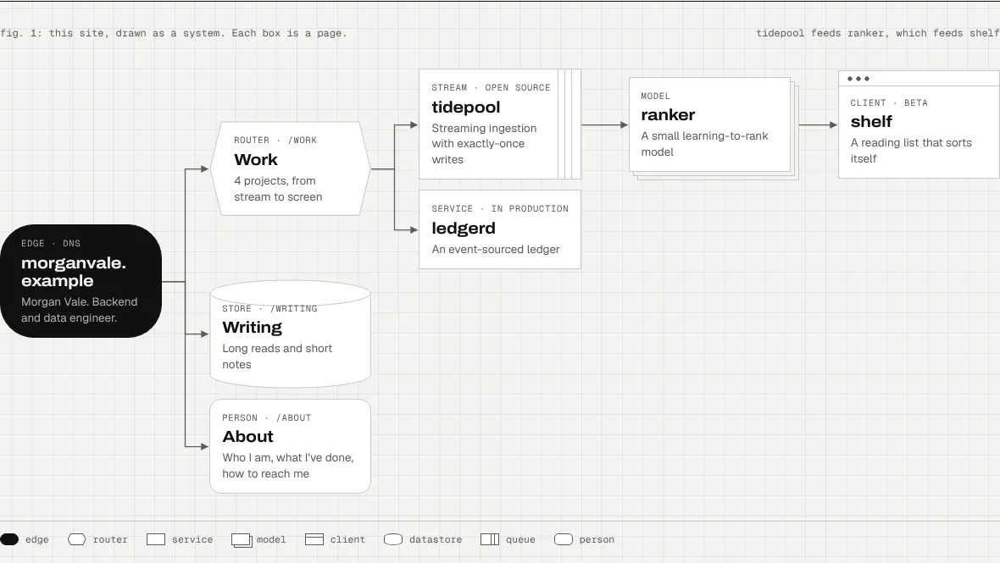
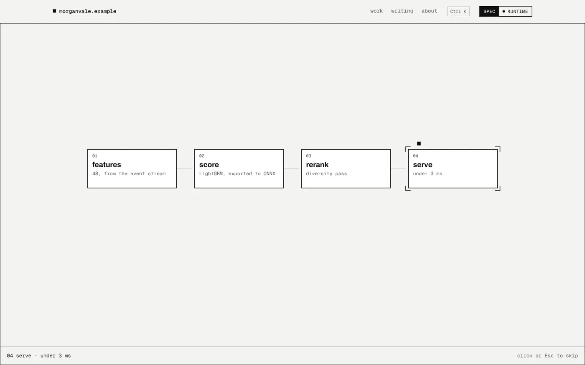

# Schema Folio: a system-diagram portfolio template

A personal site drawn as a system diagram. Your work becomes components with arrows between them,
every box is a page, and opening one sends a request through the drawing.

**[See the live demo](https://ryangswe.github.io/schema-folio/)**



It is built with [Astro](https://astro.build): static output, no server, nothing to run but the
build. The demo person, Richard Hendricks, is borrowed from *Silicon Valley*, and every `.example` address in it is reserved and
reaches no one.

## What you get

- **A map of your work.** You list the components and what feeds what. The layout is automatic: a
  box's column is its depth, and a parent sits level with its children. On a phone, or when the map
  is too deep for the page, it becomes an indented tree.
- **Shapes with meaning.** Each box takes the shape an architecture diagram would give it: edge,
  router, service, model, client, datastore, queue, person. A legend shows the ones you use.
- **Two modes.** Light is *spec*, the drawing: graph paper, arrowheads and a title block with sheet
  numbers. Dark is *runtime*, the same drawing running: moving arrows and a status bar that logs
  real load times and navigation.
- **Transitions.** Click a box and a request travels the arrows to it, then the box opens and plays
  that page's scene while the next page loads: a typed snippet, or a request flowing through named
  stages. Add your own scenes in TypeScript.
- **The rest of a site.** Project pages and a work table from Markdown, a blog with RSS, an About
  page with a hover card, a command palette (⌘K or /), a sitemap and a 404 page. Visitors who turn
  motion off get no animation.



## Start

Node 22.12 or later.

```
npm create astro@latest -- --template ryangswe/schema-folio
cd your-site
npm run dev        # http://localhost:4321
```

Or press **Use this template** on GitHub, then `npm ci` and `npm run dev` in your copy.

| Command | What it does |
| --- | --- |
| `npm run dev` | The site with live reload, drafts included |
| `npm run build` | The static site in `dist/` |
| `npm run preview` | Serves `dist/` |
| `npm run check` | Type-checks `.astro` and `.ts` files |

## Make it yours

Change these, in this order:

1. **`astro.config.mjs`**: `site`, your address, and `base` if the site lives in a folder.
2. **`src/site.config.ts`**: your name, domain, email, hero, map, About page and section snippets.
3. **`src/content/projects/`**: one Markdown file per project. Delete the demo ones.
4. **`src/content/writing/`**: your posts. Delete the demo ones.
5. **`public/`**: your photo (set `about.photo` to its path, such as `/me.webp`) and a favicon.

### Draw your system

Before you write config, sketch your work on paper: which project produces something another one
uses? The arrows matter more than the boxes. Then write the map in `src/site.config.ts`:

```ts
map: {
  caption: { spec: 'fig. 1: this site, drawn as a system.', runtime: 'live: each node is a route.' },
  nodes: [
    { id: 'root', kind: 'edge', href: '/about', tag: 'edge · dns', name: 'you.dev', sub: 'Your one-line bio.' },
    { id: 'work', kind: 'router', parent: 'root', href: '/work', tag: 'router · /work', name: 'Work', sub: '3 projects' },
    { id: 'api', kind: 'service', parent: 'work', href: '/work/api', tag: 'service', name: 'api', sub: 'What it does' },
    { id: 'app', kind: 'client', parent: 'api', href: '/work/app', tag: 'client', name: 'app', sub: 'Built on api' },
    { id: 'writing', kind: 'store', parent: 'root', href: '/writing', tag: 'store · /writing', name: 'Writing', sub: 'Posts' },
  ],
},
```

Each node names its `parent`, the box the arrow comes from. `planned: true` draws it dashed, for work
that has not shipped.

Arrows run left to right, one column per level, so more projects make the map taller, never wider.
A long chain of projects makes it wider: with `layout: 'auto'` (the default) the map is drawn as a
diagram only when every column gets at least 160px, which allows five levels on a desktop screen,
and as an indented tree otherwise. Set `layout: 'diagram'` to keep the diagram on any screen 920px or
wider, or `layout: 'tree'` to always draw the tree. Phones always get the tree.

| `kind` | Drawn as | Use it for |
| --- | --- | --- |
| `edge` | a dark pill | your domain, where requests come in |
| `router` | a hexagon | a section that fans out, like /work |
| `service` | a box | something that runs and answers requests |
| `model` | stacked layers | a trained model |
| `queue` | a box with message slots | a stream or a pipeline |
| `client` | a browser window | something people install or open |
| `store` | a cylinder | where things are kept, like your writing |
| `person` | a soft card | you |

### Projects

A project is `src/content/projects/<slug>.md` and lives at `/work/<slug>`:

```md
---
title: middle-out
summary: One or two sentences, used at the top of the page and in link previews.
blurb: A short line for the work table
tag: model · open source
year: "2014"
stack: C++, Python
order: 1                      # position in the work table
facts:
  - [Role, "Design and build"]
links:
  - { label: GitHub, href: "https://github.com/you/middle-out" }
transition:                   # optional; see below
  scene: pipeline
  stages:
    - { name: chunk, note: "split at the median" }
    - { name: verify, note: "bit for bit against the input" }
  result: lossless
draft: false
---

The case study, in Markdown.
```

The body can use two blocks of the site's own:

```html
<div class="big">
  <div><b>5.2</b><span>Weissman score on the standard test set</span></div>
</div>

<ol class="steps">
  <li><span class="n">01</span><b>Chunk</b><span>Split each block at its median.</span></li>
</ol>
```

Keep the numbers honest: say what each one measured, against what, and for how long.

### Links in your own pages

Write internal links as root paths (`/work/middle-out`). In `.astro` files, pass them through `url()`
from `src/lib/url.ts`, so they keep working when the site is served from a folder. Markdown links
are left as written, so if your site lives in a folder, include it there (`/repo/work/middle-out`).

### Writing

A post is `src/content/writing/<slug>.md` with `title`, `description`, `date`, `kind` (`long read`
or `note`) and `draft`. Drafts show in `npm run dev` and stay out of the build and the RSS feed.

### Transitions

A page's transition is set in its front matter (projects) or in `transitions` in
`src/site.config.ts` (the work, writing and about pages). Pages without one get a short default.

**`type`**: lines typed as in a terminal. `cmd` lines get a `$` prompt, `code` lines are typed bare,
`out` lines appear whole.

```yaml
transition:
  scene: type
  lines:
    - [cmd, "curl -s api/v1/health"]
    - [out, '{ "ok": true }']
```

**`pipeline`**: a request flows through named stages, each lit in turn, then the `result` shows.

```yaml
transition:
  scene: pipeline
  stages:
    - { name: features, note: "48, from the event stream" }
    - { name: score, note: "exported to ONNX" }
  result: 20 items ranked
```

**Your own scene.** A scene is an async function that draws in the opened box. Write one in
`src/scripts/scenes/`, list it in `src/scripts/scenes/index.ts`, and name it in a page's
`transition`. Anything else you put in `transition` reaches the scene as `params`.

```ts
// src/scripts/scenes/countdown.ts
import { run, tokens, type Scene } from './util';

export const countdown: Scene = (c) => {
  const T = tokens();
  c.heading.animate([{ opacity: 1 }, { opacity: 0 }], { duration: 200, fill: 'forwards' });
  return run(c, 1200, (t) => {
    c.ctx.fillStyle = T.paper; c.ctx.fillRect(0, 0, c.width, c.height);
    c.ctx.fillStyle = T.ink; c.ctx.font = `800 96px ${T.display}`;
    c.ctx.fillText(String(3 - Math.floor(t / 400)), c.width / 2 - 30, c.height / 2);
  }, c.replay ? 2 : 1);
};
```

The context (`SceneContext` in `src/scripts/scenes/util.ts`) gives you a canvas sized to the box,
the page's heading block, the status line under the box, the page's route, a `log` that writes to
the runtime status bar, and `onSkip` for when the visitor clicks or presses Esc. Read colors and
fonts with `tokens()`, so the scene works in both modes.

### Colors and fonts

Every color is a token at the top of `src/styles/global.css`, with dark values for runtime mode.
Change them there and nowhere else. The fonts are Archivo, Geist and Geist Mono, installed from
npm and served by your site.

## Deploy

The build is static, so any host works. Build command `npm run build`, output folder `dist`.

- **Cloudflare (Workers):** `wrangler.jsonc` serves `dist/`. Set its `name` to your Worker's name,
  and use `npx wrangler deploy` as the deploy command. `public/_headers` sets response headers.
- **Cloudflare Pages, Netlify, Vercel:** pick the Astro preset, or set the build command and folder
  above.
- **GitHub Pages:** `.github/workflows/pages.yml` builds and publishes on every push to `main`. In
  your copy, delete its `if:` line, then set **Settings → Pages → Source** to **GitHub Actions**. It
  serves the site at `https://<you>.github.io/<repo>/`, with `SITE_URL` and `BASE_PATH` set for that
  folder. With a custom domain, remove `BASE_PATH` from the workflow.

`.node-version` pins Node 22 for hosts that read it. The runtime status bar shows the commit that was
built, read from the host's environment or from git.

## Credits

Made by [Raymond Yang](https://raymondyang.dev), from his own site. Code under the MIT license.
Archivo, Geist and Geist Mono are under the SIL Open Font License. The "drawn with schema-folio"
link in the footer is welcome but not required.
